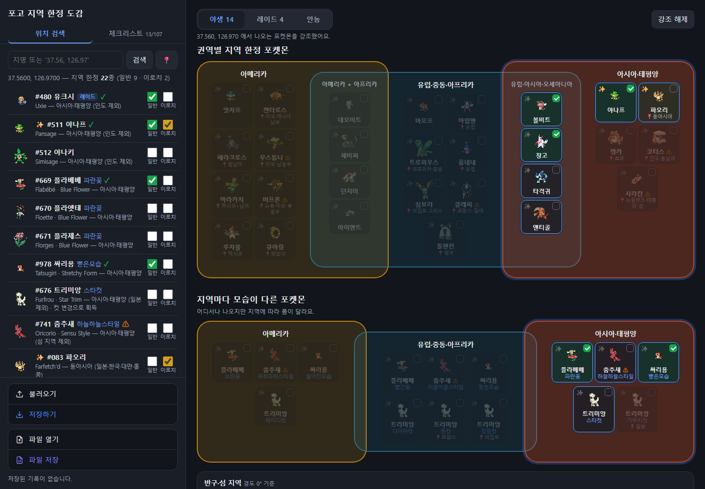
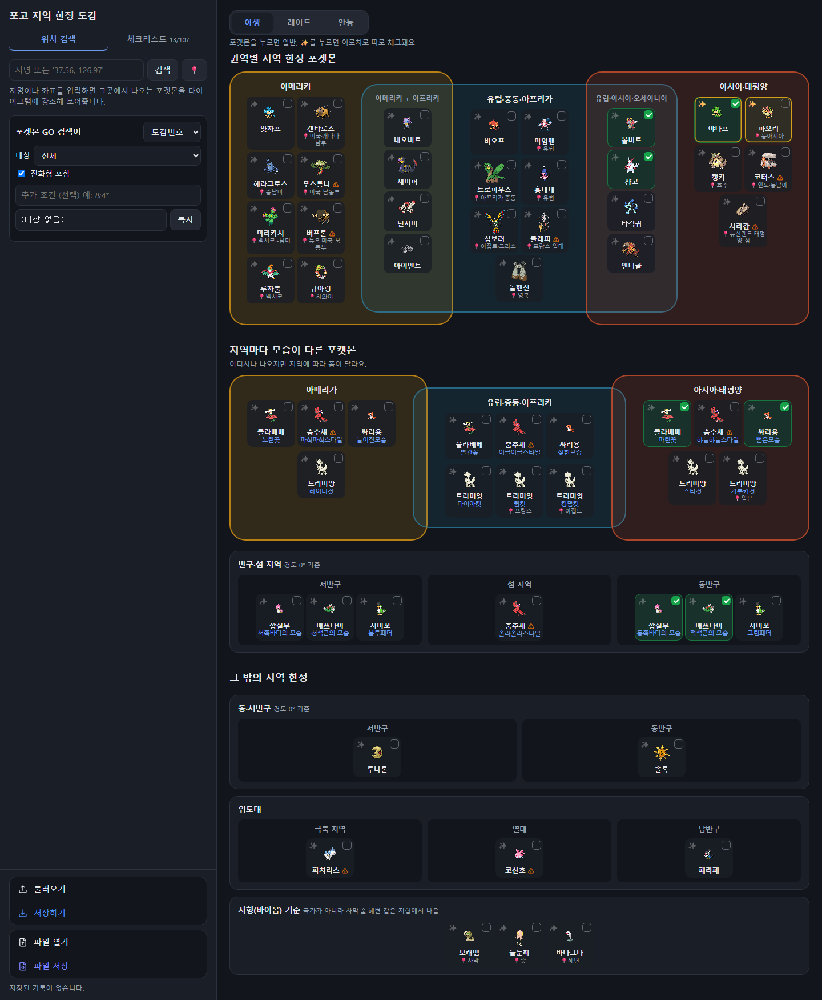
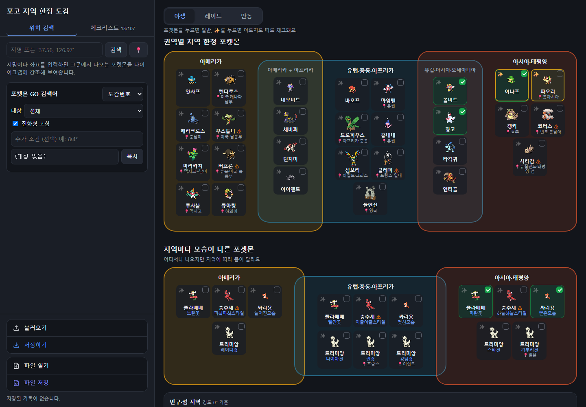
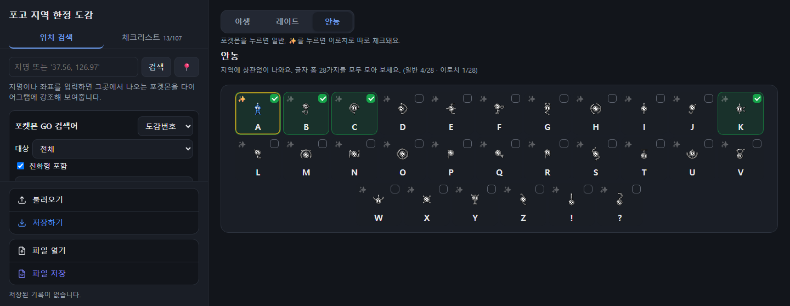

<div align="center">

</div>

# Pokemon GO Regional Dex (KR)
> 국문 명칭: 포켓몬고 지역 한정 도감 (한국어 버전)

이 리포지토리는 모바일게임 포켓몬고의 지역 한정 포켓몬과 지역마다 모습이 다른 포켓몬을 권역별로 정리하고, 일반/이로치 포획 여부를 표기/저장/복원할 수 있는 웹사이트의 소스코드를 가지고 있습니다.  
이 사이트의 모든 이미지 데이터는 주식회사 나이언틱(Niantic.) 및 주식회사 포켓몬(The Pokémon Company | 株式会社ポケモン | Pokémon, Inc.) 의 소유이며, 웹사이트의 소스코드 저작권은 제작자(github id: justin212553)에게 있음을 밝힙니다.

## 버전 정보
```
마지막 업데이트: PST 2026. 10. 11
```
## 사용 방법
<div align="center">

</div>

야생 페이지에서는 지역 한정 포켓몬을 아메리카 / 유럽·중동·아프리카 / 아시아·태평양 세 권역의 벤다이어그램으로 보여줍니다. 두 권역에 걸쳐 나오는 포켓몬(예: 네오비트는 아메리카와 아프리카, 볼비트는 유럽·아시아·오세아니아)은 사각형이 겹치는 칸에 배치됩니다.

권역 전체가 아니라 일부 지역에서만 나오는 포켓몬은 📍 표시로 해당 지역(예: 버프론 📍뉴욕·미국 북동부)을 나타내며, 경계가 특히 부정확할 수 있는 항목은 ⚠ 표시가 됩니다.

왼쪽 위치 검색 탭에 지명이나 좌표(예: 37.56, 126.97)를 입력하거나 📍 버튼으로 현재 위치를 불러오면, 그 위치에서 나오는 포켓몬만 강조되고 나머지는 흐리게 표시됩니다. 주소 끝에 `#37.56,126.97` 처럼 좌표를 붙이면 해당 위치로 바로 열 수 있습니다.

위치 검색 결과 아래에는 그 지역 포켓몬들을 게임 내에서 찾을 수 있는 포켓몬고 검색어(도감번호 또는 한글 이름)가 만들어지며, 복사 버튼으로 바로 붙여 넣을 수 있습니다. 단, 게임 검색어로는 폼을 구분할 수 없어 같은 도감번호의 다른 폼도 함께 검색됩니다.

<div align="center">

</div>

플라베베, 싸리용, 춤추새, 트리미앙처럼 어디서나 나오지만 지역에 따라 모습이 다른 포켓몬은 별도의 벤다이어그램으로 분류되어 있습니다. 깝질무, 배쓰나이, 시비꼬처럼 동·서반구(경도 0°)로 나뉘는 폼과 춤추새 훌라훌라스타일처럼 섬 지역에서만 나오는 폼은 그 아래 칸에 배치됩니다.

그 밖에 루나톤/솔록 같은 동·서반구 한정, 파치리스·코산호·페라페 같은 위도대 한정, 모래뱀·들눈해·바다그다 같은 지형(바이옴) 기준 포켓몬도 각각의 칸으로 정리되어 있습니다.

각 포켓몬 칸을 누르면 일반으로, 왼쪽 위의 ✨ 버튼을 누르면 이로치로 체크됩니다. 일반과 이로치는 서로 독립적으로 체크되므로 이로치만 가지고 있는 경우도 기록할 수 있으며, 이로치를 체크하면 이미지가 이로치 색으로 바뀝니다.

<div align="center">

</div>

레이드 페이지에서는 레이드로만 잡을 수 있는 지역 한정 포켓몬을 따로 모아 보여줍니다. 호수의 삼신(유크시·엠라이트·아그놈), 팔데아 켄타로스 3종, 울트라비스트 4종(철화구야·종이신도·차곡차곡·두파팡)이 포함되어 있습니다.

<div align="center">

</div>

안농 페이지에서는 지역에 상관없이 나오는 안농의 A~Z, !, ? 28가지 폼을 체크할 수 있습니다.

체크리스트 탭에서는 모든 포켓몬을 이름·번호·지역으로 검색하고 일반/이로치 포획 여부와 분류(야생/레이드/안농)로 필터링할 수 있습니다.

체크 내용은 브라우저에 자동으로 저장되며, 저장하기/불러오기 버튼으로 현재 상태를 백업 지점으로 남기거나 되돌릴 수 있습니다. 파일 저장/파일 열기 버튼으로는 체크 내용을 JSON 파일로 내보내거나 다른 기기에서 가져올 수 있습니다.

지역 정보는 [PokeXperience – Regionals](https://pokexperience.com/regionals/) (2026. 08. 24 검증본)을 기준으로 하며, 싸리용은 [Serebii](https://serebii.net/pokemongo/exclusives.shtml) 를 기준으로 합니다. 국경은 대략적으로 그렸으므로 경계 근처의 결과는 실제와 다를 수 있으며, 이벤트 기간에는 지역 한정 포켓몬이 다른 지역에도 나올 수 있습니다.


## 제작자 정보
제작자: justin212553 of Github

<div align="center">

</div>

```
이 웹사이트의 일부 기능은 Claude Code를 이용하여 만들어졌음을 밝힙니다.
```
